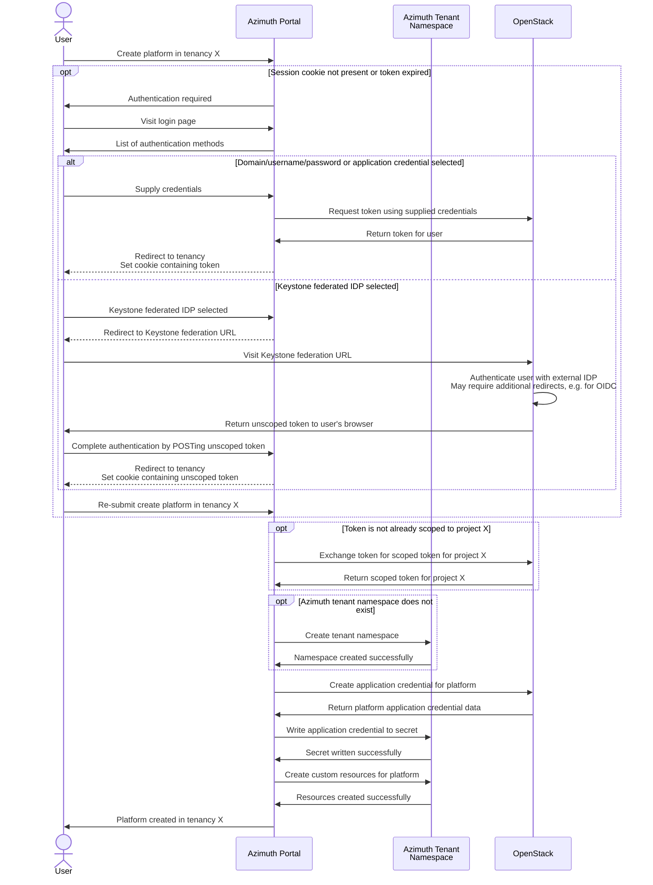
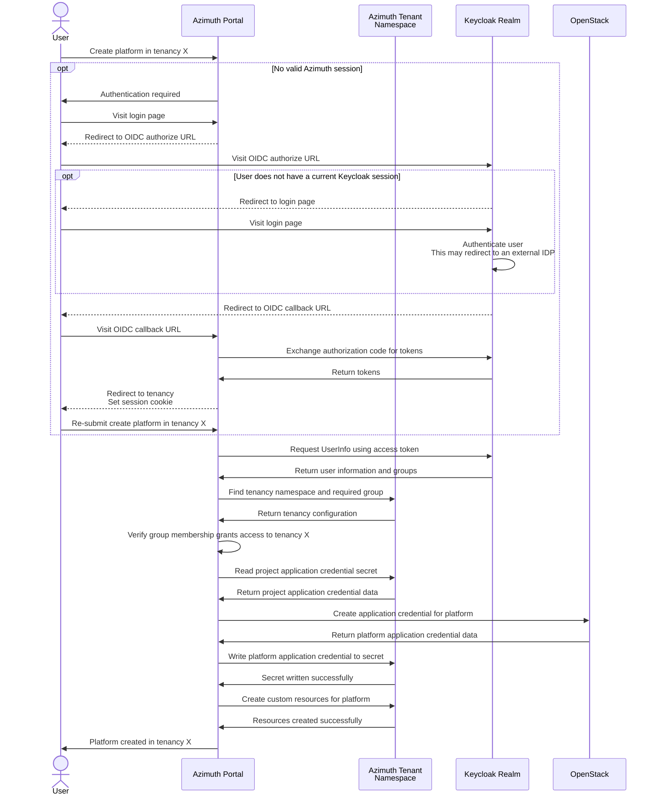
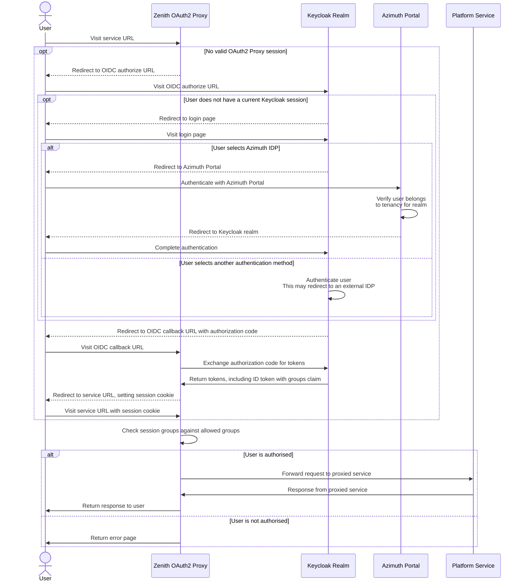

# Identity in Azimuth

This document explains how identity is designed to work in Azimuth.

## Personas

Azimuth has two distinct personas that consume Azimuth and the platforms that are deployed
using it - **platform admins** and **platform users**.

**Platform admins** are able to access the Azimuth portal where they can administer platforms
in their tenancies and the platform users that are able to access the services for those
platforms (e.g. Jupyter Notebooks, Guacamole web desktops, monitoring dashboards).

**Platform users** are able to access platform services to which they have been granted access
by a platform admin. They do not need to be able to sign in to the Azimuth portal or even be
aware that the platform is deployed in an Azimuth tenancy.

By default, platform admins are also platform users that are authorised to access all of the
services for platforms deployed in their tenancies.

The **deployment operator** is the person or team that installs and maintains Azimuth and its shared services.
Platform admins manage platforms and access within their tenancies; deployment administration uses separate credentials.

The credentials you need depend on what you are accessing:

| Interface                                                           | Authentication                                                      | Details                                                       |
| ------------------------------------------------------------------- | ------------------------------------------------------------------- | ------------------------------------------------------------- |
| Azimuth portal                                                      | OpenStack credentials or the configured OIDC provider               | [Accessing Azimuth](#accessing-azimuth)                       |
| Platform services, such as JupyterHub or a tenant cluster's Grafana | The tenancy's Keycloak realm, through Zenith                        | [Accessing platform services](#accessing-platform-services)   |
| Installation monitoring dashboards                                  | Separate HTTP Basic Auth credentials set by the deployment operator | [Accessing the monitoring](../debugging/access-monitoring.md) |

## Technologies

Azimuth utilises Kubernetes Ingress, Keycloak and Zenith to implement secure access to Azimuth
and the platforms deployed using it.

### Kubernetes Ingress

Azimuth and Zenith leverage Kubernetes Ingress as a dynamically configurable HTTP(S) proxy to
route external traffic to the correct Kubernetes service based on the hostname and/or path.

### Keycloak

As part of an Azimuth installation, a Keycloak instance is deployed. Azimuth uses this Keycloak
instance to provide authentication and authorisation for platform services exposed using Zenith,
and optionally for Azimuth itself.

### Zenith

Zenith is a tunnelling HTTP(S) proxy that is used by Azimuth to expose platform services. Using
Zenith allows Azimuth to expose platform services that are behind a NAT or firewall without
consuming public IPs.

Zenith uses a server/client model where a client initiates a secure SSH tunnel with the server
for the service that wants to be proxied. The server then forwards traffic for the proxied service
back down the tunnel. This is accomplished by creating a Kubernetes `Service` for each Zenith
service and using Kubernetes Ingress to route traffic to the correct service based on the hostname.

Zenith supports TLS termination and single sign-on using OpenID Connect (OIDC) for proxied services.
When OIDC is enabled, the Kubernetes `Ingress` routes requests through an OAuth2 Proxy for the service.
This proxy authenticates users and checks their group membership before forwarding requests to the service.

## Accessing Azimuth

Azimuth supports OpenStack authentication and OpenID Connect (OIDC) authentication.
The `azimuth_authentication_type` setting selects the authentication method and defaults to `openstack`.
With `oidc`, Azimuth can use a realm in its own Keycloak instance or an external OIDC provider.

An "Azimuth tenancy" is essentially a `Namespace` in the Azimuth Kubernetes cluster that holds
the platform definitions and related resources for that tenancy (implemented as Kubernetes custom
resources).
With OpenStack authentication, tenancies correspond to the OpenStack projects that the user can access.
With OIDC, an operator creates the tenancy namespaces and grants access through group membership.

The cloud provider is configured separately using `azimuth_cloud_provider_type`.
The default `openstack` provider needs credentials for the OpenStack project used by each tenancy.
[Standalone mode](../configuration/17-standalone-mode.md) uses the `"null"` provider and deploys apps onto existing Kubernetes clusters using a kubeconfig for each tenancy.

This section documents how this is achieved for each authentication method.

### Using OpenStack credentials

Azimuth allows authenticating directly using credentials for the underlying OpenStack cloud,
with support for domain/username/password, application credentials and Keystone federated
identity providers.

Azimuth obtains a token that can be used to interact with the OpenStack APIs on behalf of the user.
It uses this token to find the projects available to the user, which correspond to Azimuth tenancies.
To manage resources in a tenancy, Azimuth needs a _project-scoped_ token.
If the token is not already scoped to that project, Azimuth exchanges it for one that is.

An [OpenStack application credential](https://docs.openstack.org/keystone/latest/user/application_credentials.html) consists of an ID and a secret.
Azimuth uses these to authenticate with Keystone, OpenStack's identity service.

Tokens issued for application credentials are already scoped to a project and cannot be exchanged for tokens scoped to other projects.
When signing in with an application credential, the user can therefore access only the corresponding Azimuth tenancy.

When authenticating using OpenStack credentials, Azimuth will create the corresponding tenant
namespaces automatically when required.

The following sequence diagram shows a typical flow for creating a platform in an Azimuth
tenancy using OpenStack authentication:

### Using a Keycloak realm

<!-- prettier-ignore-start -->
!!! warning
    OIDC authentication is currently in technology preview and is not recommended for production.
<!-- prettier-ignore-end -->

To use OIDC authentication with the Keycloak instance deployed by Azimuth, set `azimuth_authentication_type: oidc`.
When `azimuth_oidc_issuer_url` is unset, `azimuth-ops` creates the users realm (`azimuth-users` by default).
It also creates an OIDC client for the portal when `azimuth_oidc_client_secret` is unset.
These resources are managed by the identity operator.

The deployment administrator must still configure users or external identity providers, tenancy groups and group membership.
Keycloak supports providers such as Microsoft Entra, Google, LDAP and OIDC, as well as policies such as multi-factor authentication.
Platform admins signing in through OIDC do not need their own OpenStack accounts.

Alternatively, set `azimuth_oidc_issuer_url`, `azimuth_oidc_client_id` and `azimuth_oidc_client_secret` to use an existing OIDC provider and client.
In this case, `azimuth-ops` does not create the users realm or the client.

Configure each tenancy namespace with a `tenant.azimuth-cloud.io/id` label and a `tenant.azimuth-cloud.io/oidc-group` annotation naming the group that grants access.
Azimuth uses the access token to query the OIDC provider's UserInfo endpoint on each request.
It matches the user's groups against these annotations to find the tenancies they can access.
The groups claim defaults to `groups` and can be changed with `azimuth_oidc_groups_claim`.

The [azimuth-tenant-config repository](https://github.com/azimuth-cloud/azimuth-tenant-config) provides example tenancy namespaces and credential secrets.
For standalone deployments, see the [tenancy setup guide](../configuration/17-standalone-mode.md#tenancy-creation).

#### Obtaining an OpenStack credential

When OIDC authentication is used with the OpenStack provider, the operator must create an application credential for each tenancy's OpenStack project and store it in a Kubernetes `Secret` in that tenancy's namespace.
The secret must have the label `credential.azimuth-cloud.io/provider: openstack` and a single data key containing the `clouds.yaml` configuration.
Azimuth uses this credential to manage cloud resources on behalf of users.
The null provider used in standalone mode does not need an OpenStack credential.

<!-- prettier-ignore-start -->
!!! warning
    The application credentials must be **unrestricted**, meaning that they have the ability to
    create additional application credentials. This is so that Azimuth can still create the
    per-platform application credentials that are used to manage platform resources.

!!! tip
    It is recommended that Azimuth has a service account in the underlying OpenStack that owns
    the application credentials used by Azimuth. This service account will need to belong to all
    the projects that you wish to use Azimuth with. This avoids all of the application credentials
    used by Azimuth being tied to an individual OpenStack user who may have access to the cloud
    revoked, e.g. if they leave the organisation.
<!-- prettier-ignore-end -->

The following sequence diagram shows a typical flow for creating a platform on OpenStack using the Keycloak realm for authentication:

## Accessing platform services

Access to platform services in Azimuth is mediated using Keycloak, regardless of how the user
authenticates with Azimuth and the mechanism for obtaining a cloud credential.

Azimuth manages a realm in Keycloak for each Azimuth tenancy, and the platform users for a
tenancy are users that exist in the associated Keycloak realm. These users can be local Keycloak
users or users from a federated identity provider such as Microsoft Entra, Google or LDAP.

By default, this realm has a single federated IDP that allows users belonging to the tenancy to
sign in using their existing Azimuth session (i.e. platform admins). Users that sign in using
this method are automatically added to an `admins` group that allows them to administer the realm
and grants access to all platform services for the tenancy. Platform admins are able to manage
local users and federated identity providers in this realm as required for their needs.

Within this realm, Azimuth then manages an OpenID Connect client for each platform service and
a group that is used to grant access to that service. Zenith is configured to use this OIDC
client and group when performing authentication and authorisation for the service.

Platform admins can grant a platform user access to a platform service by adding them to the
group for that service. Keycloak has powerful features for automatically mapping users from
federated identity providers into groups if desired.

The following diagram shows the sequence of actions for a user accessing a platform service:

## Working on identity

Portal authentication is implemented in [`api/azimuth_auth`](https://github.com/azimuth-cloud/azimuth/tree/master/api/azimuth_auth).
The portal creates tenancy realm resources in [`api/azimuth/identity.py`](https://github.com/azimuth-cloud/azimuth/blob/master/api/azimuth/identity.py), and the [identity operator](https://github.com/azimuth-cloud/azimuth-identity-operator) manages their configuration in Keycloak.
[Zenith](https://github.com/azimuth-cloud/zenith) handles authentication for proxied platform services.
See [Developing Azimuth](../developing/index.md) for local checks and setting up a development instance.
